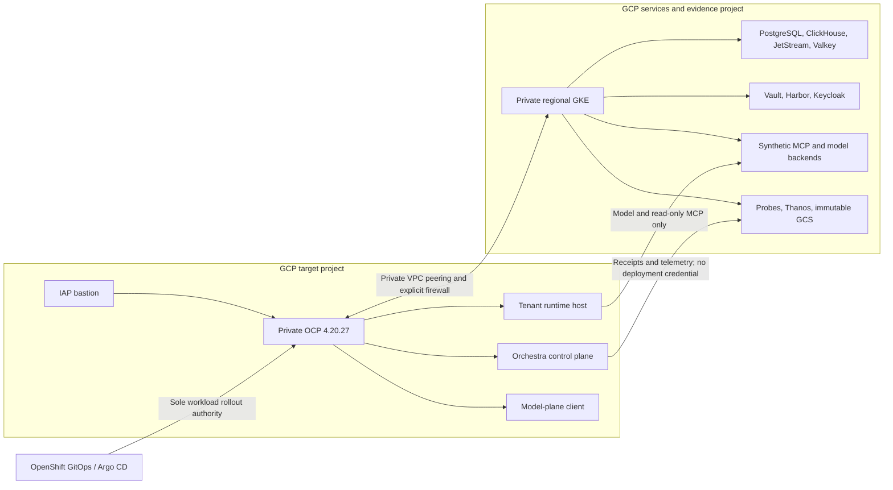

# Reference-lab architecture

## Trust zones

## Boundary invariants

1. The tenant gateway and runtime path remain tenant-plane components.
   Orchestra is not a synchronous production proxy.
2. OpenShift GitOps owns promotion, hold, rollback, and workload credentials.
   Orchestra emits signed recommendations and observes the result.
3. Platform agent-query and production tool-execution paths remain disabled.
   The runtime may call only the pinned model plane and read-only synthetic MCP
   allowlist during this campaign.
4. The target project and dependency/evidence project are separate. Peering is
   private, non-transitive, and protected by explicit ingress and egress rules.
5. Evidence writers cannot mutate infrastructure. Fault controllers cannot
   approve or sign certification results. Reviewers cannot execute drills.
6. Generated Secret values are never stored in Git. External Secrets resolves
   Vault references at runtime.

## Source-of-truth split

- This repository: infrastructure, GitOps, synthetic surfaces, campaigns,
  fault orchestration, and runbooks.
- `prometa-platform`: certification contracts, aggregation, platform probes,
  policy/evidence behavior, and certification-runner source.
- `orchestra-python-sdk`: runtime-host lifecycle and MCP probes.
- `llm_inference_engine`: routing, inference, TLS, fairness, fallback,
  embedding, and lifecycle probes.

Changing a product-owned behavior here is prohibited. A product fix creates a
new immutable artifact in its owning repository, updates the cross-plane
release set, and reruns affected evidence.
