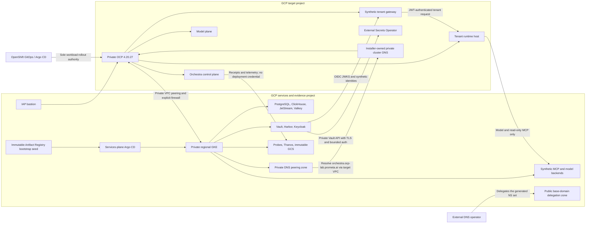

# Reference-lab architecture

## Trust zones

## Boundary invariants

1. The tenant gateway and runtime path remain tenant-plane components.
   Orchestra is not a synchronous production proxy.
2. OpenShift GitOps owns promotion, hold, rollback, and workload credentials.
   Orchestra emits signed recommendations and observes the result.
3. Platform agent-query and production tool-execution paths remain disabled.
   The runtime may call only the pinned model plane and read-only synthetic MCP
   allowlist during this campaign.
4. The target project and dependency/evidence project are separate. Peering is
   private, non-transitive, and protected by explicit ingress and egress rules.
5. Evidence writers cannot mutate infrastructure. Fault controllers cannot
   approve or sign certification results. Reviewers cannot execute drills.
6. Generated Secret values are never stored in Git. External Secrets resolves
   Vault references at runtime.
7. OpenShift GitOps owns tenant-plane product rollout. A separate
   services-plane Argo CD instance owns GKE dependencies, starts from the
   immutable Artifact Registry seed, and cannot mutate OpenShift products.
8. The dependency AppProject remains continuously denied until a reviewed
   image-level admission overlay is committed. A source chart lock is not an
   executable deployment approval.
9. The synthetic tenant gateway may contact Keycloak and the runtime host only.
   Its runtime credential is tenant-owned, and it has no platform API key or
   deployment credential. Tenant-beta identities are adversarial inputs, not a
   second certified tenant.
10. Synthetic MCP deployments expose one read-only, idempotent tool. Slow,
    unavailable, wrong-tenant, and untrusted-certificate lanes are separate
    immutable deployments; none may enable write or destructive behavior.
11. External Secrets is an OpenShift controller. It consumes the private Vault
    service in GKE through explicit peering, TLS, and a bounded Kubernetes auth
    role; services-plane Argo CD never installs it into GKE.
12. The services project owns the public `ocp-lab.prometa.ai.` zone only for
    explicit delegation and domain-control proof. The OpenShift installer owns
    private cluster records in the target VPC; services-plane consumers reach
    those records through one-way Cloud DNS peering and cannot mutate them.

## Source-of-truth split

- This repository: infrastructure, GitOps, synthetic surfaces, campaigns,
  fault orchestration, runbooks, and immutable intake of the platform-owned
  certification contract.
- `prometa-platform`: authoritative certification contracts, aggregation,
  platform probes, policy/evidence behavior, and certification-runner source.
- `orchestra-python-sdk`: runtime-host lifecycle and MCP probes.
- `llm_inference_engine`: routing, inference, TLS, fairness, fallback,
  embedding, and lifecycle probes.

Changing a product-owned behavior here is prohibited. A product fix creates a
new immutable artifact in its owning repository, updates the cross-plane
release set, and reruns affected evidence.

The lab vendors the exact platform policy, schema bundle, and fixture bytes
from the release-set revision so campaign tooling can validate without a
runtime dependency on another private repository. Raw and canonical digests
plus optional upstream Git-object replay detect substitution. Vendoring is an
intake mechanism, not ownership transfer; the fixture remains
`fixture/simulated` and cannot authorize a live campaign.

The topology, release set, and dependency BOM are separate canonical inputs.
Campaigns bind their digests independently;
none can be inferred from another. Mirroring an accepted release into Harbor
records destination digests and lab signatures as deployment evidence without
rewriting the source release set.
